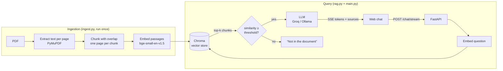

# RAG Document Chatbot

Ask questions about a PDF and get answers grounded in its text, with clickable page citations. Built as a full small application: an ingestion pipeline, a retrieval-augmented generation (RAG) core, a REST API with streaming, and a web chat interface.

**Live demo:** https://ragchatbot-07jy.onrender.com/ 
_Hosted on a free tier, so the first load may take up to a minute while the server wakes up._


## Features

- **Grounded answers.** The model answers only from retrieved document excerpts and says so when the answer isn't in the document.
- **Page citations.** Answers cite pages like `[p. 4]`; in the UI each citation is clickable and opens the matching source excerpt.
- **Streaming responses.** Tokens arrive in real time over Server-Sent Events, with a stop button.
- **Follow-up questions.** Recent conversation history is sent with each question.
- **Relevance threshold.** If no excerpt is similar enough to the question, the LLM isn't called at all, which prevents made-up answers and saves API calls.
- **Provider-agnostic LLM.** Switch between Groq (cloud) and Ollama (fully local) with one environment variable.
- **Documented API.** Request validation with Pydantic and interactive Swagger docs at `/docs`.

## Architecture



## Tech stack

| Layer | Technology |
|---|---|
| PDF parsing | PyMuPDF |
| Embeddings | fastembed (`BAAI/bge-small-en-v1.5`, ONNX, CPU) |
| Vector store | ChromaDB (persistent, cosine similarity) |
| LLM | Groq API (`openai/gpt-oss-120b`) or Ollama, via the OpenAI-compatible client |
| Backend | FastAPI, Pydantic, Uvicorn |
| Frontend | Plain HTML, CSS and JavaScript (no build step) |
| Deployment | Docker, Render |

## Project structure

```
rag-chatbot/
├── config.py          # all settings, read from .env
├── ingest.py          # PDF → chunks → embeddings → Chroma
├── rag.py             # retrieval + prompt + LLM call (also a terminal chat)
├── main.py            # FastAPI app: /health, /chat, /chat/stream, serves the UI
├── static/
│   └── index.html     # web chat interface
├── data/
│   └── document.pdf   # the document to chat with
├── requirements.txt
├── Dockerfile         # container image; builds the index at build time
├── .dockerignore
└── .env.example
```

## Getting started

### 1. Install

Requires Python 3.10+ (3.11 or 3.12 recommended).

```bash
git clone https://github.com/AhmedCirak/rag-chatbot.git
cd rag-chatbot
python -m venv .venv

# Windows
.venv\Scripts\activate
# macOS / Linux
source .venv/bin/activate

pip install -r requirements.txt
```

### 2. Configure

Copy `.env.example` to `.env` and add a free API key from [console.groq.com](https://console.groq.com):

```env
LLM_PROVIDER=groq
GROQ_API_KEY=your_key_here
LLM_MODEL=openai/gpt-oss-120b
```

To run fully locally instead, install [Ollama](https://ollama.com), run `ollama pull llama3.2:3b` and set `LLM_PROVIDER=ollama`.

### 3. Index the document

Put your PDF at `data/document.pdf`, then:

```bash
python ingest.py --query "What is this document about?"
```

The `--query` flag prints the top matching chunks and their similarity scores, which is handy for checking retrieval and tuning the threshold.

### 4. Run

```bash
uvicorn main:app --reload
```

Open [http://localhost:8000](http://localhost:8000) for the chat, or [http://localhost:8000/docs](http://localhost:8000/docs) for the API docs.

You can also chat in the terminal with `python rag.py`.

## Configuration

| Variable | Default | Description |
|---|---|---|
| `LLM_PROVIDER` | `groq` | `groq` or `ollama` |
| `GROQ_API_KEY` | | Required when using Groq |
| `LLM_MODEL` | `openai/gpt-oss-120b` (Groq), `llama3.2:3b` (Ollama) | Model name |
| `OLLAMA_BASE_URL` | `http://localhost:11434/v1` | Ollama endpoint |
| `TOP_K` | `4` | Number of chunks retrieved per question |
| `MIN_SIMILARITY` | `0.5` | Chunks below this cosine similarity are discarded |

## Deployment

The app runs as a Docker container on [Render](https://render.com). The image installs the dependencies, copies the code and the PDF, and runs `ingest.py` during the build, so the vector index is ready the moment the server starts. The Groq API key is set as an environment variable in Render and never stored in the repository. Every push to `main` triggers a new deploy.

To run the container locally:

```bash
docker build -t rag-chatbot .
docker run -p 7860:7860 -e GROQ_API_KEY=your_key_here rag-chatbot
```

## API

| Method | Endpoint | Description |
|---|---|---|
| `GET` | `/health` | Server status, model, document name and chunk count |
| `POST` | `/chat` | Full answer with sources in one response |
| `POST` | `/chat/stream` | Answer streamed as Server-Sent Events |

Example request:

```bash
curl -X POST http://localhost:8000/chat \
  -H "Content-Type: application/json" \
  -d '{"question": "What is the main conclusion?", "history": []}'
```

Example response:

```json
{
  "answer": "The main conclusion is ... [p. 12]",
  "sources": [
    { "source": "document.pdf", "page": 12, "similarity": 0.71, "snippet": "..." }
  ]
}
```

`/chat/stream` emits these events in order: `sources` (once, before the answer), `token` (many times), and `done` (once). If generation fails midway, an `error` event is sent instead of the remaining tokens.

## Design decisions

- **Chunking per page.** Each page is chunked separately, so every chunk maps to exactly one page and citations are always exact. Chunks are packed by paragraph, then by sentence, with a word-aligned overlap. The chunker is written from scratch rather than taken from a framework, to keep every step transparent.
- **Asymmetric embeddings.** Documents are embedded as passages and questions as queries, which is how the BGE model was trained and gives better retrieval than embedding both the same way.
- **Similarity threshold before generation.** Retrieval quality decides whether the LLM is called at all. Off-topic questions get a fixed “not found” answer instead of a confident hallucination.
- **One client for every LLM provider.** Groq and Ollama both expose an OpenAI-compatible API, so switching providers is a configuration change, not a code change.
- **Synchronous endpoints.** Embedding, vector search and the LLM call are blocking operations, so the endpoints are plain `def` functions. FastAPI runs them in a thread pool, which keeps the server responsive under concurrent requests.
- **Streaming with sources first.** Sources are known as soon as retrieval finishes, so they are sent before the first token. The frontend reads the stream with `fetch` and `ReadableStream`, because the browser's `EventSource` only supports GET requests.
- **Models load at startup.** The embedding model and index are loaded when the server starts, so the first user doesn't wait, and `/health` reports clearly if the index is missing.


## Author

 [@AhmedCirak](https://github.com/AhmedCirak)